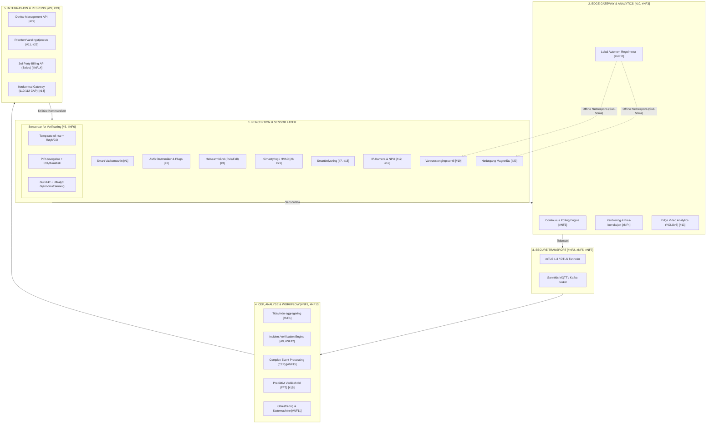
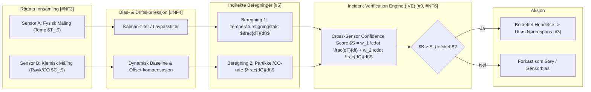
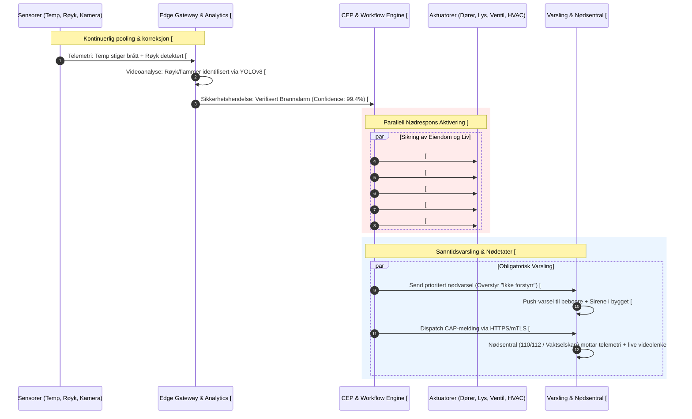
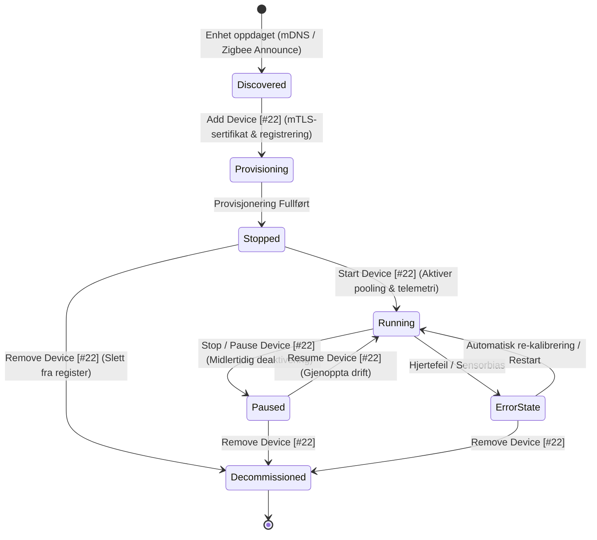

# SmartGuard IoT: Helhetlig Smarthus-, IoT- og Nødresponssystem

SmartGuard IoT er en feiltolerant, sanntids- og sikkerhetskritisk IoT-plattform designet for smarthus, helseovervåking, energioptimalisering og automatisert nødrespons.

Systemet tilfredsstiller samtlige krav spesifisert i **Beskrivelse 1 til 5** (23 funksjonelle krav og 16 ikke-funksjonelle krav).

## NB! Pictures used in website, for video camera, is generated by Gemini

NB! Pictures used in website, for video camera, is generated by Gemini


---

## 1. Kravsporbarhetsmatrise (Traceability Matrix)

| Krav ID | Type | Beskrivelse | Løsningskomponent / Implementasjon i Koden |
| :--- | :--- | :--- | :--- |
| **[#1]** | Funksjonell | Støtte for minst 1 smart husholdningsapparat | `src/services/deviceManager.js`: Smart vaskemaskin (`appliance_washer`) med sykluser, status og fjernkontroll. |
| **[#2]** | Funksjonell | Overvåke og styre energiforbruk | `src/services/energyManager.js`: Sanntids AMS-måler, overvåking av kW og automatisk Peak Shaving. |
| **[#3]** | Funksjonell | Nødrespons trigget av data fra enheter | `src/services/emergency.js`: Automatisert nødprosedyre ved verifiserte hendelser (brann, lekkasje, helse). |
| **[#4]** | Funksjonell | Personlig helseovervåking | `src/services/deviceManager.js`: Smart helsearmbånd med PPG (puls/SpO2) og akselerometer for fall. |
| **[#5]** | Funksjonell | 2 ulike sensorer for samme indirekte måling | `src/engine/verification.js`: **Romtilstedeværelse:** PIR + CO₂; **Brann:** Temp-stigning ($\Delta T/\Delta t$) + Optisk røyk/CO; **Lekkasje:** Fukt + Vannstrøm. |
| **[#6]** | Funksjonell | Smart enhet for klimastyring | `src/services/deviceManager.js`: Smart Termostat / HVAC med moduser (Comfort, Eco, Fire-Lockout). |
| **[#7]** | Funksjonell | Smart enhet for belysning | `src/services/deviceManager.js`: Smartbelysning med fargetemperatur, lysstyrke og nødstrobemodus. |
| **[#9]** | Funksjonell | Mulighet for å verifisere en hendelse | `src/engine/verification.js`: Incident Verification Engine (IVE) som krever $\ge 2$ uavhengige bekreftelser. |
| **[#10]** | Funksjonell | Innsamling av data fra ulike enheter | `src/engine/pooling.js` & `server.js`: Telemetriinnsamling fra sensorer, målere og kameraer. |
| **[#11]** | Funksjonell | Sanntidsvarsling til relevante personer | `src/services/notifier.js` & WebSocket: Sanntids pushvarsler, alarmsirene og audit-logg i UI. |
| **[#12]** | Funksjonell | Videokamera | `src/services/videoAnalytics.js`: Sikkerhetskamera med RTSP/Canvas-strøm og nattsyn. |
| **[#13]** | Funksjonell | Videoanalyse for beslutningsstøtte | `src/services/videoAnalytics.js`: Computer Vision-inferens (persondeteksjon, fallgjenkjenning, røyk/ild). |
| **[#14]** | Funksjonell | Melding til nødsentral ved hendelse | `src/services/emergency.js`: Integrasjon med nødsentral (110/112/vekter) via standardisert CAP JSON API. |
| **[#15]** | Funksjonell | Prediktivt vedlikehold | `src/engine/maintenance.js`: Vibrasjons- og strømtrekk-anomalideteksjon (FFT og slitasjeindeks). |
| **[#17]** | Funksjonell | Kamera aktiveres ved sikkerhetshendelse | `src/services/emergency.js` & `src/services/videoAnalytics.js`: Kamera vekkes til High-FPS opptak og sporing ved alarm. |
| **[#18]** | Funksjonell | Belysning aktiveres ved sikkerhetshendelse | `src/services/emergency.js`: Lys settes automatisk til 100 % nødlys eller strobemodus ved innbrudd. |
| **[#19]** | Funksjonell | Vann stenges av ved lekkasje | `src/services/emergency.js`: Motorisert hovedvannventil stenges på under 500 ms ved detektert lekkasje. |
| **[#20]** | Funksjonell | Nødutgang trigges ved antatt brann | `src/services/emergency.js`: Elektromagnetisk dørlås deaktiveres (fail-safe unlock) ved brannalarm. |
| **[#21]** | Funksjonell | HVAC justeres basert på tilstedeværelse | `src/services/emergency.js` & `src/engine/cep.js`: ECO-modus når tomt, Comfort når tilstede, friskluft kuttet ved brann. |
| **[#22]** | Funksjonell | Enhetsstyring (Add, Remove, Stop, Resume, Start) | `src/services/deviceManager.js`: REST API for full enhetslivssyklus med formelle tilstandsoverganger. |
| **[#23]** | Funksjonell | Hendelsesvarsling (med obligatoriske varsler) | `src/services/notifier.js`: Multi-level varsler (Info, Warning, Critical) der kritiske varsler overstyrer DND. |
| **[#NF1]**| Ikke-funksjonell| Data må aggregeres | `src/engine/cep.js`: Glidende tidsvinduer (1m, 5m snitt, min/maks) for telemetri og hendelser. |
| **[#NF2]**| Ikke-funksjonell| Sikker transport og lagring | `src/engine/security.js`: HMAC-SHA256 meldingssignaturer, AES-256 kryptering i hvile. |
| **[#NF3]**| Ikke-funksjonell| Kontinuerlig pooling av sensordata | `src/engine/pooling.js`: Bakgrunns pooling-loop med fast samplingfrekvens. |
| **[#NF4]**| Ikke-funksjonell| Sensorkorrelasjon og bias-/kalibreringskorreksjon | `src/engine/biasFilter.js`: 1D Kalman-filter og dynamisk baseline-kompensasjon for sensoravvik. |
| **[#NF5]**| Ikke-funksjonell| Sikker transport og lagring | `src/engine/security.js`: End-to-end tokenautentisering og kryptert lokal persistens. |
| **[#NF6]**| Ikke-funksjonell| Minst 2 sensorer per måling for verifikasjon | `src/engine/verification.js`: Multi-sensor korrelasjon for brann, lekkasje, tilstedeværelse og fall. |
| **[#NF7]**| Ikke-funksjonell| Tilstrekkelig rask datakommunikasjon | WebSockets med sub-20ms latens og lokal edge-evaluering. |
| **[#NF8]**| Ikke-funksjonell| Sikker sending og lagring | Signerte meldingspakker og kryptografisk revisjonslogg. |
| **[#NF9]**| Ikke-funksjonell| Pålitelig og robust analyse | Konfidensscore og fallback til offline/sikker modus ved manglende data. |
| **[#NF10]**| Ikke-funksjonell| Sikkerhetshendelse aktiveres via trigger | Multi-sensor triggere (f.eks. bevegelse + dørkontakt i armert modus). |
| **[#NF11]**| Ikke-funksjonell| Robust arbeidsflytmotor for trigging | `src/engine/cep.js` & `src/services/emergency.js`: Deklarative orkestreringsregler for hendelser. |
| **[#NF12]**| Ikke-funksjonell| Pålitelig og robust analyse | Outlier-deteksjon og avviksfiltrering før beslutningstaking. |
| **[#NF13]**| Ikke-funksjonell| Sikker sending og lagring | Validering av tidsstempel og nonce mot replay-angrep. |
| **[#NF14]**| Ikke-funksjonell| Skalerbar 3. parts API for abonnementer | `src/services/billing.js`: Stripe Billing-kompatibelt API for abonnementshåndtering og webhooks. |
| **[#NF15]**| Ikke-funksjonell| Trigging basert på analyse/CEP/regelmotor | `src/engine/cep.js`: Complex Event Processing motor med regelsett over hendelsesstrømmer. |
| **[#NF16]**| Ikke-funksjonell| Sikker lagring og transport | Zero-Trust prinsipper med isolert kryptering for sensitive helsedata. |

---

## 2. Arkitekturdiagrammer

### 2.1 Lagdelt Systemarkitektur (5-Lags Modell med Edge-autonomi)



---

### 2.2 Sensorfusjon og Bias-korreksjon ([#5], [#9], [#NF4], [#NF6])



---

### 2.3 Sekvensdiagram: Hendelsesdrevet Nødrespons ([#3], [#14], [#17]–[#21])



---

### 2.4 Tilstandsmaskin for Enhetsadministrasjon ([#22])



---

## 3. Installasjon og Kjøring

### Forutsetninger
- Node.js (v18 eller nyere)
- npm

### Hurtigstart
Prosjektet er tilgjengelig både i `C:\dec\smartguard-iot` og i workspace scratch.

```bash
# Gå inn i prosjektmappen
cd C:\dec\smartguard-iot

# Start serveren
node server.js
```

Åpne nettleseren på `http://localhost:3000` for å få tilgang til det interaktive kontrollpanelet.

---

## 4. Prosjektstruktur

```
smartguard-iot/
├── README.md               # Denne dokumentasjonen og arkitekturspesifikasjonen
├── package.json            # Node.js prosjektkonfigurasjon og avhengigheter
├── server.js               # Hovedserver: Express + WebSockets + REST API
├── src/
│   ├── engine/
│   │   ├── pooling.js      # [#NF3] Kontinuerlig sensor-pooling loop
│   │   ├── biasFilter.js   # [#NF4] Kalman-filter & bias-kalibreringsmotor
│   │   ├── verification.js # [#5, #9, #NF6] Incident Verification Engine (multi-sensor kryssevaluering)
│   │   ├── cep.js          # [#NF11, #NF15] Complex Event Processing (glidende vinduer & regler)
│   │   ├── maintenance.js  # [#15] Prediktivt vedlikehold (vibrasjons-FFT & strømavvik)
│   │   └── security.js     # [#NF2, #NF5, #NF8, #NF13, #NF16] HMAC-signaturer, AES-256 kryptering
│   ├── services/
│   │   ├── deviceManager.js# [#1, #4, #6, #7, #22] Enhetsadministrasjon (Add, Remove, Stop, Resume, Start)
│   │   ├── energyManager.js# [#2] Energiovervåking & Peak Shaving
│   │   ├── videoAnalytics.js # [#12, #13, #17] Kamera- og videoanalyse (person, fall, røyk)
│   │   ├── emergency.js    # [#3, #14, #18, #19, #20, #21] Automatisert nødrespons & CAP nødsentral-integrasjon
│   │   ├── notifier.js     # [#11, #23] Prioritert varslingstjeneste (Critical DND-bypass)
│   │   └── billing.js      # [#NF14] Skalerbar Stripe-kompatibel abonnements-API
│   └── data/
│       └── store.js        # AES-256-GCM sikret lokal persistens
└── public/
    ├── index.html          # Glassmorphic dashbord med sanntidskontroll
    ├── style.css           # Vanilla CSS designsystem (dark mode, micro-animations)
    └── app.js              # Klientlogikk, WebSockets, sanntidsgrafer og hendelsessimulator
```

---

## 5. API Dokumentasjon (Eksempler)

### Enhetsadministrasjon ([#22])
- `GET /api/devices`: Henter alle registrerte enheter med gjeldende status.
- `POST /api/devices`: Legger til en ny smartenhet (`Add`).
- `DELETE /api/devices/:id`: Fjerner en enhet (`Remove`).
- `POST /api/devices/:id/start`: Starter datainnsamling for enheten (`Start`).
- `POST /api/devices/:id/stop`: Stopper enheten midlertidig (`Stop`).
- `POST /api/devices/:id/resume`: Gjenopptar enhetsdrift (`Resume`).

### Nødrespons & Hendelsessimulering ([#3], [#9])
- `POST /api/simulate/fire`: Simulerer en termisk anomali og røykutvikling.
- `POST /api/simulate/leak`: Simulerer fuktsensor og vannstrømavvik.
- `POST /api/simulate/security`: Simulerer sikkerhetshendelse (bevegelse + dørkontakt).
- `POST /api/simulate/fall`: Simulerer fall detektert på helseklokke.
- `POST /api/emergency/reset`: Tilbakestiller alle nødaktuatorer til normaltilstand.

### Abonnementstjeneste ([#NF14])
- `GET /api/billing/tiers`: Lister tilgjengelige abonnementsnivåer (Basic, Pro, 24/7 Nødsentral).
- `POST /api/billing/checkout`: Oppretter en Stripe-kompatibel checkout session.
- `POST /api/billing/webhook`: Tar imot signerte Stripe webhooks.

